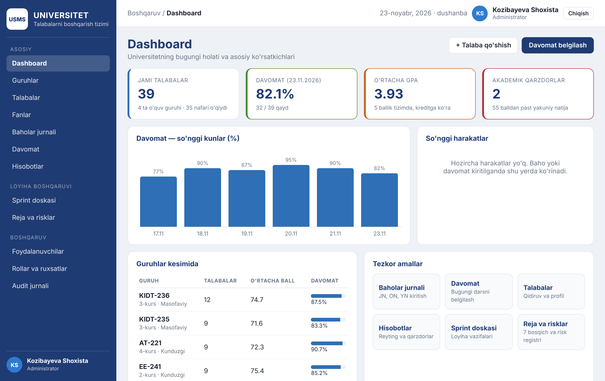

# Universitet talabalarini boshqarish tizimi (USMS)

Talabalar, o'quv guruhlari, fanlar, baholar va davomatni boshqarish uchun web ilova.
«Loyihalarni boshqarish» fanidan 6-mavzu bo'yicha amaliy loyiha.

**Muallif:** Kozibayeva Shoxista Alisher qizi, Masofaviy KIDT-236 guruhi
**Tekshiruvchi:** Shixnazar Xusainov

## Imkoniyatlar
- Rollar va ruxsatlar (Administrator, Dekanat xodimi, O'qituvchi, Kurator, Talaba)
- Fakultetlar va o'quv guruhlari
- Talabalar bazasi: qidiruv, filtr, holat, CSV eksport
- Fanlar, kreditlar va o'qituvchini biriktirish
- Baholar jurnali (JN 30 + ON 20 + YN 50), GPA hisobi
- Davomat (keldi / sababsiz / sababli), qoldirilgan soatlar
- Hisobotlar: reyting, akademik qarzdorlar, davomat, guruhlar kesimida
- Loyiha boshqaruvi: sprint doskasi, Gantt va risk registri
- Audit jurnali (har bir baho o'zgarishi qayd etiladi)

## Demo hisoblar
| Rol | Login | Parol |
|---|---|---|
| Administrator | admin@usms.uz | admin123 |
| Dekanat xodimi | dekanat@usms.uz | dekanat123 |
| O'qituvchi | teacher@usms.uz | teacher123 |
| Kurator | kurator@usms.uz | kurator123 |
| Talaba | student@usms.uz | student123 |

Barcha ma'lumotlar namunaviy va brauzerning localStorage xotirasida saqlanadi.

## Ishga tushirish
`index.html` faylini brauzerda oching yoki GitHub Pages orqali ochiladi.

## Texnologiyalar
HTML5, CSS3, JavaScript (ES2020), localStorage. Kelgusi bosqichlarda: React, ASP.NET Core 8, PostgreSQL.

## Bosqichlar (7 ta laboratoriya)
1. Arxitektura va foydalanuvchilar
2. Fakultetlar va guruhlar
3. Talabalar bazasi
4. Fanlar va o'quv yuklamasi
5. Baholash tizimi
6. Davomat va hisobotlar
7. Dashboard, test va deploy

## Litsenziya
MIT
